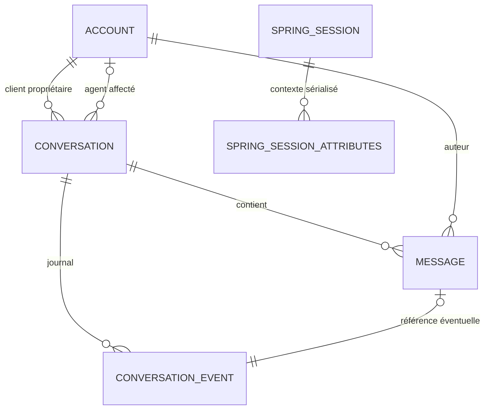

# Contrat réalisé et structure des données — PoC 1.0

Référence de cette réalisation : `ChatController`, `ChatService` et migration V1. Ce document actualise le contrat représentatif de l’étape 3. Il ne décrit pas les API de réservation ou de paiement.

## Session et sécurité

Base locale `/api/v1`. Session serveur transmise par cookie HttpOnly `YCYWSESSION`, même origine. GET `/csrf` crée un cookie `XSRF-TOKEN` ; les commandes POST transmettent sa valeur dans `X-XSRF-TOKEN`. Après connexion/déconnexion récupérer à nouveau `/csrf`. Aucun auteur ou rôle n’est accepté dans la commande de message. Pas de CORS interorigine autorisé par la configuration.

| Méthode et chemin | Entrée | Résultat principal |
| --- | --- | --- |
| GET `/health` | Aucune | 200 `{status:"UP"}` ; diagnostic de processus, pas preuve de disponibilité de la base |
| GET `/csrf` | Aucune | 204 et token CSRF |
| POST `/session` | Formulaire URL-encoded `username`, `password` + CSRF | 200 `{ok:true}` et session ; 401 si échec |
| GET `/session` | Session | 200 acteur : id, email, displayName, role |
| POST `/logout` | Session + CSRF | 204 ; session invalidée |
| GET `/conversations` | Session | Liste des conversations propres, affectées ou métadonnées de file selon rôle |
| POST `/conversations` | Client, JSON `{}`, en-tête UUID `Idempotency-Key` | 200 vue de conversation ; répétition de même clé retourne la même ressource |
| GET `/conversations/{id}` | Participant | 200 vue autorisée |
| POST `/support/conversations/{id}/claim` | Support, CSRF | 200 affectation exclusive ; 409 si déjà affectée à un autre |
| POST `/support/conversations/{id}/release` | Agent affecté, CSRF | 200 ; accès aux messages révoqué pour cet agent |
| POST `/conversations/{id}/closure` | Participant, CSRF, `If-Match` version numérique | 200 ; 412 si version périmée |
| POST `/conversations/{id}/messages` | Participant, CSRF, `{clientMessageId:UUID,text:string}` | 201 après commit ; 200 pour réessai identique ; 409 si clé différente de contenu ou nouvel envoi clôturé |
| GET `/conversations/{id}/messages` | Participant, `limit` 1..100 (50 par défaut), `beforeSequence` OU `afterSequence` | Page ordonnée avec items, eventCursor, nextMessageCursor et hasMore |
| GET `/conversations/{id}/events` | Participant, `after` ≥0 ou en-tête `Last-Event-ID` | Flux SSE authentifié ; reprise strictement après curseur |

La liste des conversations est limitée aux 100 plus récentes ; elle n’est pas paginée dans la PoC.

Les UUID malformés, curseurs invalides et champs non admis sont refusés. Un `reservationId` non nul est refusé : ce contexte est exclu de la PoC. 401 : session requise ; 403 : commande interdite/CSRF ; 404 : absent ou non autorisé, sans divulguer l’existence ; 422 : contenu invalide ; 429 : limitation pédagogique. Les erreurs métier utilisent `application/problem+json` avec `type`, `title`, `status`, `code` ; les filtres de sécurité utilisent un JSON `code/title`.

Une conversation contient `id`, `ownerId`, `assignedAgentId` nullable, `ownerName`, `status`, `version`, `eventCursor`. Un message contient `id`, `sequence`, `clientMessageId`, `senderRole`, `text`, `createdAt`, `status` (RECORDED). Les dates sont des instants ; l’interface les affiche selon le fuseau du navigateur. Il n’existe pas d’accusé de lecture.

## Pagination et reprise

Sans curseur, renvoyer les derniers messages dans l’ordre croissant, avec watermark capturé dans la transaction d’historique. `beforeSequence` charge les messages antérieurs ; `afterSequence` récupère les suivants. Un curseur de message et un curseur d’événement sont des positions de la même séquence de conversation, mais tous les événements ne sont pas des messages. La fin de rattrapage permet d’avancer à `eventCursor` ; ne pas avancer à ce watermark avant de consommer toutes les pages `hasMore`.

Le SSE émet `id: sequence`, `event: message.created|assigned|released|closed`, et une référence JSON `sequence` et éventuellement `messageId`. Le corps du message est ensuite relu sous contrôle d’accès. Des commentaires keep-alive n’avancent pas le curseur. Les contrôles session/compte/participation sont renouvelés périodiquement et avant émission ; une référence déjà transmise ne peut être rappelée. EventSource reprend automatiquement un flux interrompu ; la suspension volontaire de démonstration ferme la connexion et la réouvre depuis le watermark connu.

## Modèle réduit de données

Le détail physique exécutable est `backend/src/main/resources/db/migration/V1__chat_and_sessions.sql`.

| Table | Rôle et contraintes principales |
| --- | --- |
| `account` | UUID, email unique, rôle CLIENT/SUPPORT, hash PBKDF2, actif ; identités fictives |
| `conversation` | Client propriétaire, agent facultatif, WAITING/ACTIVE/CLOSED, compteur de séquence, version, unicité propriétaire/clé de création |
| `message` | Conversation, auteur, clé client ; unicité conversation/auteur/clé et conversation/séquence ; texte borné, non vide |
| `conversation_event` | Séquence unique par conversation, type et message éventuel ; même transaction que le changement métier |
| `spring_session` et `spring_session_attributes` | Schéma JDBC Spring Session, index d’expiration et de principal ; séparation de l’identité et de la session |

Les clés étrangères maintiennent les relations ; les index uniques couvrent idempotence et parcours ordonné. La suppression du compte, les durées de conservation métier et la purge des messages ne sont pas implémentées dans ce sous-ensemble. Les comptes sont initialisés par `DemoData`, après migration, uniquement en local/test.

## Opération d’envoi

1. Identifier l’acteur de la session et vérifier qu’il est encore actif.
2. Verrouiller la conversation et vérifier sa participation.
3. Valider la clé et le texte ; retrouver d’abord une éventuelle répétition identique, même après clôture.
4. Pour un nouvel envoi, refuser une conversation clôturée, allouer la séquence, insérer message et événement dans la même transaction.
5. Retourner RECORDED au retour du service transactionnel ; diffuser ensuite la référence persistée.

Cela fournit une déduplication métier durable. Le réseau peut perdre ou répéter les notifications ; la conception ne promet pas une transmission « exactement une fois ».
