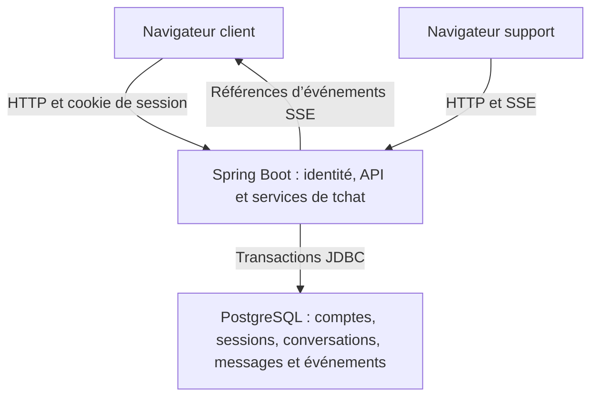

# Architecture réalisée et adaptations de la conception

## Socle conservé

Java 21, Spring Boot 4.1.2, Angular 21.2, PostgreSQL, sessions JDBC, CSRF et HTTP + SSE. Aucun paiement, fournisseur d’identité externe ni courriel réel. Les comptes sont fictifs ; l’authentification et les contrôles d’accès sont réels. Aucun mode de production n’est fourni.

## Adaptations explicites

| Décision de conception | Réalisation PoC et justification |
| --- | --- |
| ADR-03/04 : persistance Spring Data JPA | Spring JDBC, transactions Spring et requêtes paramétrées : moins de mapping pour le sous-ensemble tchat et verrous SQL visibles. Base relationnelle et invariants inchangés. Aucun ORM en mémoire. |
| ADR-05 : fanout local après commit et rattrapage périodique | Lecture du journal d’événements toutes les secondes côté serveur pour les flux ouverts. Le navigateur n’effectue pas de polling périodique. Cela réduit la complexité et répare les notifications perdues ; coût SQL à mesurer avant montée en charge. |
| Participation et affectation | Propriétaire et agent affecté matérialisent les deux participants ; pas de table de groupe arbitraire. Une file WAITING expose uniquement les métadonnées nécessaires au support ; accès aux messages refusé avant affectation. La libération révoque l’accès de l’ancien agent. |
| Contrat de création | POST /conversations retourne 200 pour la vue courante, y compris répétition idempotente. Clé Idempotency-Key obligatoire ; aucun contexte de réservation réel admis. |
| Déconnexion | POST /api/v1/logout avec CSRF, plutôt que DELETE /session, pour utiliser le filtre standard Spring Security. |
| Interface SPA/CSRF | Cookie XSRF-TOKEN et en-tête X-XSRF-TOKEN ; requêtes fetch de même origine dans un composant Angular. Pas de token d’identité dans localStorage. Le gestionnaire CSRF utilise le token brut pour cette API, sans désactivation globale de CSRF. L’utilisation du gestionnaire de token brut désactive l’encodage anti-BREACH du token sur cette API locale ; aucune compression de réponse n’est activée et aucun secret n’est rendu dans une page HTML. Ce choix doit être revu pour une exposition réelle. |
| Versions frontend | Core/compiler 21.2.25 et CLI/build 21.2.29 : même branche compatible 21.2, correctifs différents selon les paquets officiels ; versions exactes dans package-lock.json. |
| Session | Session JDBC 30 min par défaut ; flux SSE borné à 120 s et reprise EventSource. Lecture périodique de session et vérification d’accès avant émission. La fermeture réseau se constate au prochain passage (environ une seconde), pas de garantie de rappel d’une donnée déjà transmise. |
| Limites | 2 000 points de code Unicode, pages 50/max 100, 120 tentatives d’envoi/minute/compte, 4 flux/session et 40 flux au total. Limites pédagogiques, pas objectifs de production. |
| Environnement d’essai ici | Docker absent ; le binaire PostgreSQL 17.11 a pu être récupéré, mais son initialisation native est empêchée par le seul UID disponible et les restrictions de changement d’utilisateur du conteneur. Des essais complémentaires utilisent PostgreSQL 18.6 WebAssembly via PGlite 0.5.13 et pglite-socket 0.2.16. Ce n’est pas une validation de PostgreSQL 17 natif ni de ses garanties de concurrence. Compose et CI restent sur PostgreSQL 17 natif. |

## Invariants implémentés

Le service verrouille la conversation, contrôle les droits et la clé, alloue une séquence puis insère message et événement dans une transaction. La réponse RECORDED intervient au retour du service transactionnel, après commit. Un réessai identique autorisé retrouve le message existant même si la conversation a été clôturée depuis. Un identifiant réutilisé avec un autre texte produit 409. Un nouvel envoi après clôture est refusé.

La séquence couvre aussi affectation/libération/clôture. Le flux SSE transmet une référence, jamais une preuve de lecture. Le navigateur récupère les données autorisées en HTTP, rattrape toutes les pages avant d’avancer son curseur, puis déduplique par identifiant. L’historique initial et son watermark sont lus dans une transaction REPEATABLE_READ. Aucun « exactement une fois » sur le réseau n’est annoncé.

## Limites assumées

Une instance seulement. Pas de file distribuée, ni HA, ni support public. La limitation d’abus est locale en mémoire. Les brouillons incertains survivent à une coupure réseau dans la page, pas à sa fermeture, à une déconnexion volontaire ou à un rechargement complet. Le résultat d’un message déjà commité reste consultable dans l’historique. Pas de pièces jointes, présence, saisie en cours ou accusé de lecture.

Avant toute production : revue sécurité, politique de conservation, configuration HTTPS/secrets, mesure de charge et accessibilité complète, et suppression du profil de démonstration.
